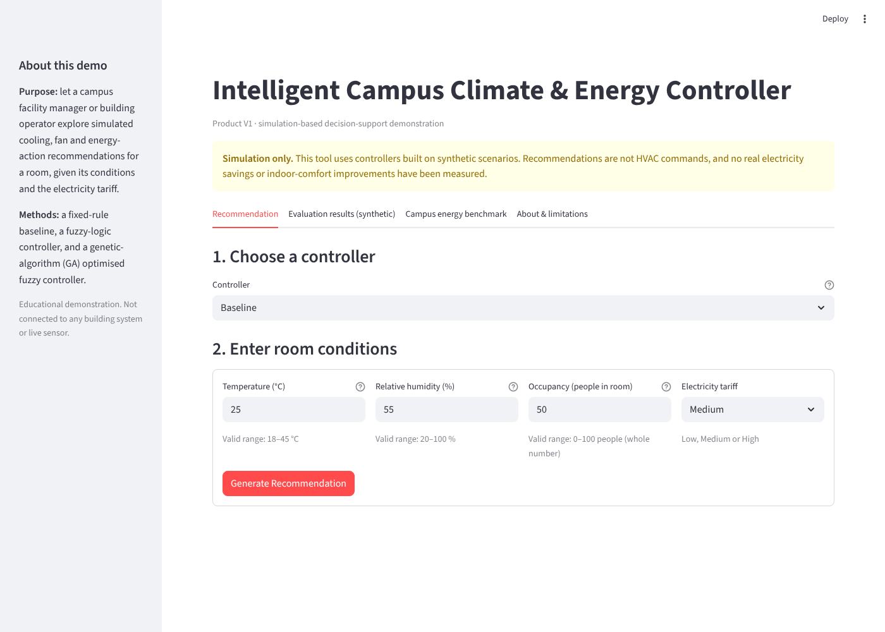
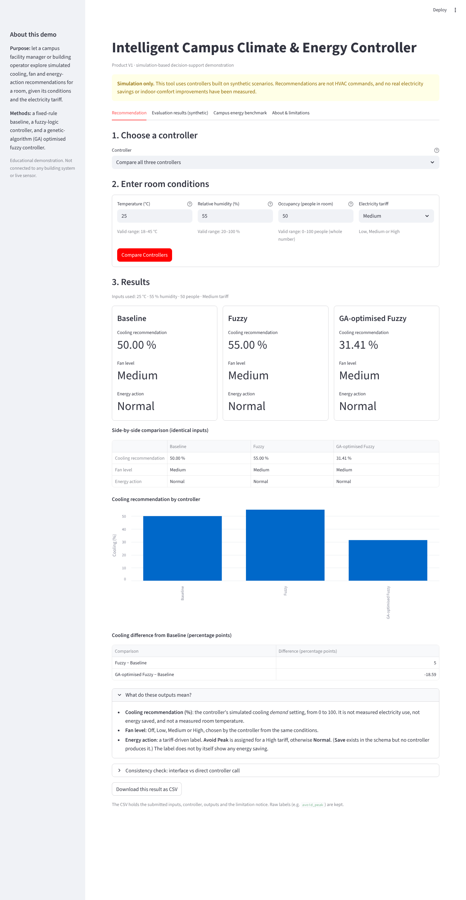
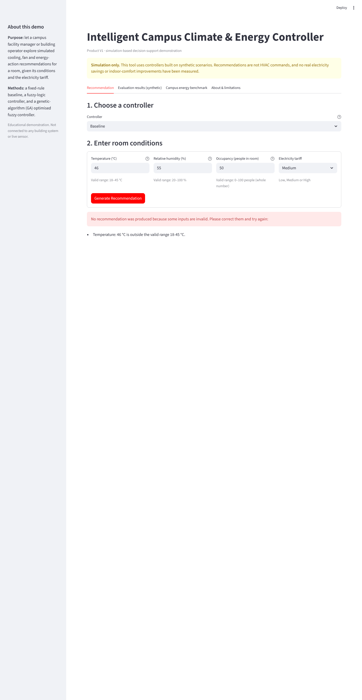

# Step 5 - Product V1

## 1. Team and project

- Team name: **TEAM ALGORITHM**
- Project: **SC01 - Intelligent Campus Climate and Energy Controller**
- Repository: https://github.com/vansh-sharma01/SC01-Intelligent-Campus-Climate-and-Energy-Controller
- Branch: `step-5-product-v1`, created from the verified `step-6-evaluation` checkpoint, commit `8e00b92`. `main` and `step-6-evaluation` were not modified. (The Product V1 commit hash is shown by `git log -1` on this branch; a file cannot contain the hash of the commit that contains it.)
- Report date: 23 November 2026

## 2. User task and purpose

**User:** a campus facility manager or building operator.

**Task:** explore *simulated* cooling, fan and energy-action recommendations for a room, given its temperature, humidity, number of occupants and the current electricity tariff category, and compare how three controllers respond to identical conditions.

**This is a simulation-based decision-support demonstration.** It is not connected to any building system or live sensor, and its outputs are not HVAC commands.

## 3. Interface and entry file

| Item | Value |
|---|---|
| Interface type | Streamlit web application (runs locally) |
| Entry file | `app/app.py` |
| Inference / validation module | `src/product_inference.py` |
| Consistency-check script | `src/check_product_consistency.py` |
| Tests | `src/test_product_v1.py` (inference layer), `src/test_product_v1_app.py` (interface), existing `src/test_step4_requirements.py` |
| Hosted demo | None for Product V1 (local demonstration). The earlier public deployment tracks `step-6-evaluation` and is unaffected by this branch. |

## 4. Connection to the existing controllers

The interface does **not** re-implement any controller. `src/product_inference.py` calls the same functions used by the Step 3-7 experiments:

| Controller | Existing implementation used |
|---|---|
| Baseline | `baseline_controller()` in `src/baseline_controller.py` |
| Fuzzy | `fuzzy_controller()` in `src/fuzzy_controller.py` (default parameters) |
| GA-optimised Fuzzy | the same `fuzzy_controller()` with the saved parameters in `results/step6/ga_best_params.json` |

- No controller is trained or re-optimised when a button is pressed. The GA is never imported by the application (checked by an automated test).
- The saved GA parameters are read once per server process. If the file is missing or invalid, a clear error is shown; the application never silently substitutes the ordinary fuzzy controller.
- Existing controller logic, rule definitions, datasets and Step 3-7 result files are unchanged.

## 5. Input schema, valid ranges and units

Validation is performed in the inference layer (`validate_inputs`), not only in the interface, so invalid values cannot reach a controller.

| Field (code name) | Interface label | Unit | Valid values |
|---|---|---|---|
| `temperature_c` | Temperature | °C | 18 to 45 |
| `humidity_pct` | Relative humidity | % | 20 to 100 |
| `occupancy_count` | Occupancy (people in room) | people, **whole number** | 0 to 100 |
| `tariff_level` | Electricity tariff | category | `low`, `medium`, `high` (case and surrounding spaces are normalised; nothing else is accepted) |

Rejected, with a field-specific message and no recommendation: blank or missing values, text, booleans, NaN, infinity, out-of-range numbers, non-integer occupancy, unknown tariff. All problems are reported together. Invalid values are never replaced by defaults.

Notes on the schema, checked against the repository:

- **Occupancy is a count of people (0-100), not a percentage**, in every existing script and document.
- **Humidity range:** the Step 1 contract (`docs/STEP-1.md`), the data generator and the generated data use 20-100 %, and Product V1 enforces that. The older batch validator `src/validate_data.py` (and README section 3) accepts 0-100 %. That older validator was left unchanged because an existing test relies on it; see Remaining issues.

## 6. Output labels, units and meaning

| Output | Values | Meaning |
|---|---|---|
| Cooling recommendation (`cooling_pct`) | 0-100 % | The controller's simulated cooling *demand* setting. **Not** measured electricity use, energy saved, or room temperature. |
| Fan level (`fan_level`) | Off, Low, Medium, High | Fan setting chosen by the controller from the same conditions. |
| Energy action (`energy_action`) | Normal, Avoid Peak (Save is defined in the schema but **no controller produces it**) | Tariff-driven label: High tariff gives Avoid Peak, otherwise Normal. It does not by itself show any energy saving. |

Raw lowercase labels (e.g. `avoid_peak`) are kept in CSV downloads; the screen shows readable labels.

## 7. Application data flow

`User input` -> `Input validation (validate_inputs)` -> `Existing controller (baseline / fuzzy / fuzzy + saved GA parameters)` -> `Output checks (cooling 0-100, valid fan level and action)` -> `Result display / CSV`

Interface sections: Recommendation (controller choice, input form, results, comparison, consistency check, CSV download); Evaluation results (saved 10,000-scenario results, read from the existing CSV files); Campus energy benchmark (external Galgotias context, shown separately); About & limitations. A "Simulation only" notice is visible at the top of every tab.

## 8. Environment and dependencies

- Dependency file: `requirements-product-v1.txt` (contains `-r requirements.txt`). Product V1 needs no package beyond the project's existing pinned set; Streamlit 1.50.0 was already pinned in `requirements.txt`. No package was upgraded.
- **Tested in the development environment used to produce this evidence (Linux sandbox):**

| Python | Streamlit | pandas | numpy | matplotlib |
|---|---|---|---|---|
| 3.11.18 (primary) | 1.50.0 | 2.3.3 | 2.0.2 | 3.9.4 |
| 3.13.18 (secondary) | 1.50.0 | 2.3.3 | 2.0.2 | 3.9.4 |

  `pyarrow` (26.0.1) is installed by Streamlit and is not pinned by the project.
- **Team's Mac development environment (verified 23 November 2026):**

  | Python | pandas | NumPy |
  |---|---|---|
  | 3.9.6 | 2.3.3 | 2.0.2 |

- **Product V1 verification on the team's Mac:**
  - Inference and application-interface tests: **51/51 passed**.
  - Direct controller comparisons: **45/45 matched**.
  - Saved Step 7 evaluation: **30,000/30,000 exact matches**.
  - Cooling differences: 0.
  - Fan/action mismatches: 0.

## 9. Setup and launch

Run everything from the repository root.

```bash
# one-time setup
python3 -m venv .venv
source .venv/bin/activate
python -m pip install -r requirements-product-v1.txt

# launch
python -m streamlit run app/app.py
```

- Working directory: repository root (the folder containing `app/`, `src/`, `results/`).
- Entry file: `app/app.py`.
- Local URL: http://localhost:8501 (if the port is busy, add `--server.port 8502`).
- Stop the application with `Ctrl+C` in the terminal.
- Known restrictions: the application reads `results/step6/ga_best_params.json`, `results/step7/*.csv` and `data/external/galgotias/*.csv`, so run it from a complete checkout. Local use only; hosting is optional.

Automated tests:

```bash
python -m unittest discover -s src -p "test_*.py" -v
python src/check_product_consistency.py
```

## 10. Actual test evidence

All results below were produced by running the code; each row says where it came from. Evidence files are in `docs/evidence/step5/`.

**How the browser checks were run:** the real Streamlit server was started (`terminal-streamlit-start.txt`) and driven in real Google Chrome by a script (Playwright). The script typed each value, pressed the real button, and recorded what the page displayed (`browser_test_log.json`); screenshots came from that same session. This is a scripted browser run, not a person clicking by hand. The team should repeat a few checks by hand on its own computer (see Remaining issues).

### 10.1 Automated results

| Check | Python 3.11.18 | Python 3.13.18 | Evidence |
|---|---|---|---|
| Full suite: 11 existing + 39 inference-layer + 12 interface tests | **62/62 OK** | **62/62 OK** | `terminal-unit-tests-python3.11.txt`, `terminal-unit-tests-python3.13.txt` |
| Consistency Part A: interface layer vs direct controller calls (15 inputs x 3 controllers) | 45/45 match | 45/45 match | `terminal-consistency-check-*.txt`, `results/product_v1/consistency_cases.csv` |
| Consistency Part B: interface layer vs saved Step 7 evaluation (10,000 scenarios x 3 controllers) | 30,000/30,000 exact | 29,999 exact; 1 cooling value differs by 0.01 (see Remaining issues); 0 fan/action mismatches | same |

Deliberate-fault check: breaking the layer three ways (widening the humidity range, falling back silently when the GA file is missing, accepting 20.5 occupancy) made the tests fail each time (2, 7 and 2 failures); the unmodified code gave 0 failures.

The tests do not show that any controller saves energy or improves comfort; they check validation, wiring and consistency only.

### 10.2 Test table

| Case | Actual input or evidence path | Expected behaviour | Observed behaviour | Pass/Fail |
|---|---|---|---|---|
| Normal, Baseline | 25 °C, 55 %, 50 people, Medium. `03-recommendation-baseline.png`, `browser_test_log.json` | Three real outputs, no error | 50.00 % / Medium / Normal | Pass |
| Normal, compare all three | same inputs. `04-controller-comparison.png` | Three controllers' outputs for identical inputs | Baseline 50.00 % / Medium / Normal; Fuzzy 55.00 % / Medium / Normal; GA-optimised Fuzzy 31.41 % / Medium / Normal | Pass |
| Boundary: temperature 18 | others normal | Accepted, real output | 10.00 % / Low / Normal (Baseline) | Pass |
| Boundary: temperature 45 | `06-boundary-temperature-45.png` | Accepted | 90.00 % / Medium / Normal | Pass |
| Boundary: humidity 20 | others normal | Accepted | 50.00 % / Medium / Normal | Pass |
| Boundary: humidity 100 | others normal | Accepted | 50.00 % / High / Normal | Pass |
| Boundary: occupancy 0 | `06b-boundary-occupancy-0.png` | Accepted; empty room | 0.00 % / Off / Normal | Pass |
| Boundary: occupancy 100 | others normal | Accepted | 50.00 % / Medium / Normal | Pass |
| Each tariff: Low, Medium, High | others normal | Accepted | Normal, Normal, Avoid Peak | Pass |
| Invalid: temperature 46 | `05-invalid-temperature-46.png` | Field error, no recommendation | "Temperature: 46 °C is outside the valid range 18-45 °C." No result, no traceback | Pass |
| Invalid: temperature 17 | browser log | same | "Temperature: 17 °C is outside the valid range 18-45 °C." | Pass |
| Invalid: humidity 101 | browser log | same | "Humidity: 101 % is outside the valid range 20-100 %." | Pass |
| Invalid: humidity 19 | browser log | same | "Humidity: 19 % is outside the valid range 20-100 %." | Pass |
| Invalid: occupancy -1 | browser log | same | "Occupancy: -1 people is outside the valid range 0-100 people." | Pass |
| Invalid: occupancy 101 | browser log | same | "Occupancy: 101 people is outside the valid range 0-100 people." | Pass |
| Invalid: occupancy 20.5 | browser log | same | "Occupancy: enter a whole number of people." | Pass |
| Invalid: text `abc` in temperature | `05c-invalid-temperature-text.png` | same | "Temperature: enter a number." | Pass |
| Invalid: blank humidity | `05b-invalid-humidity-blank.png` | same | "Humidity: enter a value (20-100 %)." | Pass |
| Invalid: `nan` in temperature | browser log | same | "Temperature: use a finite number (not NaN or infinity)." | Pass |
| Invalid: `inf` in occupancy | browser log | same | "Occupancy: use a finite number (not NaN or infinity)." | Pass |
| Invalid: unknown tariff, missing keys, booleans, several errors at once | `src/test_product_v1.py` (the tariff is a dropdown in the interface, so these are tested at the inference layer) | `InputValidationError` naming each field | Tests pass (62/62) | Pass |
| Recovery after an error | browser log | Valid input afterwards gives a recommendation | 50.00 % / Medium / Normal | Pass |
| Missing GA parameter file (temporary copy of the project without `ga_best_params.json`; original untouched) | `11-missing-ga-parameters.png`, `missing_resource_test_log.json` | Clear error; no fake result; other controllers keep working | GA-optimised Fuzzy and Compare: "A controller could not be loaded: Saved GA parameters not found: results/step6/ga_best_params.json ..." with no traceback and no result; Baseline still returned 50.00 % / Medium / Normal | Pass |
| Same input through interface and direct controllers | `test_product_v1_app.py` (drives the real `app/app.py`), in-app "Consistency check" expander, `consistency_cases.csv` | Identical outputs | Identical for all three controllers in all tested cases | Pass |
| CSV download | `downloaded_sc01_product_v1_recommendation.csv` | Contains submitted inputs, controller, outputs and notice | Three rows (baseline, fuzzy, ga_fuzzy) with 25.0, 55.0, 50, medium, cooling 50.0 / 55.0 / 31.41, fan medium, action normal, and the limitation notice, matching the screen | Pass |
| Evaluation and campus-benchmark tabs | `08-evaluation-tab.png`, `09-campus-benchmark-tab.png` | Values equal the saved CSV files; benchmark clearly separate | Mean cooling 62.23 / 70.72 / 47.60 and the fan, energy-action and pairwise-difference counts match `results/step7/` exactly | Pass |
| Run on the team's own computer (`.venv`), with a real terminal screenshot | - | Same results | **Pending** | **Pending** |

## 11. Controller consistency checks

- `src/check_product_consistency.py` compares the interface layer with direct calls to the three existing controllers (the five Step 1 test cases, a normal case, each boundary on its own, each tariff) and with the saved Step 7 evaluation file for all 10,000 scenarios. Results are written to `results/product_v1/` (new folder; Step 3-7 evidence is not touched).
- The application also shows this check live: after each result, the "Consistency check" expander recomputes the same inputs by calling the existing controllers directly and shows whether they match.
- These checks confirm wiring, not controller quality.

## 12. Screenshots and evidence paths

All in `docs/evidence/step5/`.

| Evidence | File |
|---|---|
| Home page / overview | `01-home-overview.png` |
| Input form | `02-input-form.png` |
| Successful recommendation | `03-recommendation-baseline.png` |
| Controller comparison | `04-controller-comparison.png` |
| Invalid-input messages | `05-invalid-temperature-46.png`, `05b-invalid-humidity-blank.png`, `05c-invalid-temperature-text.png` |
| Boundary tests | `06-boundary-temperature-45.png`, `06b-boundary-occupancy-0.png` |
| Downloaded output | `downloaded_sc01_product_v1_recommendation.csv` (and `07-downloaded-output-page.png`) |
| Evaluation, benchmark, limitations tabs | `08-evaluation-tab.png`, `09-campus-benchmark-tab.png`, `10-limitations-tab.png` |
| Missing-resource handling | `11-missing-ga-parameters.png`, `missing_resource_test_log.json` |
| Terminal: application started | `terminal-streamlit-start.txt` (text capture of the real terminal output) |
| Terminal: automated tests | `terminal-unit-tests-python3.11.txt`, `terminal-unit-tests-python3.13.txt` |
| Terminal: consistency check | `terminal-consistency-check-python3.11.txt`, `terminal-consistency-check-python3.13.txt` |
| Browser test observations | `browser_test_log.json` |

The terminal items are text captures of real output, not images of a terminal window. The team may add its own terminal screenshots.





## 13. Earlier Step 1-4 feedback addressed

The project received **Provisional Acceptance (8.5/10)** in the earlier evaluation.

| Evaluator expectation | Project response and current status |
|---|---|
| Compare the fuzzy controller with the fixed-rule baseline using identical input scenarios. | This comparison was implemented using the same synthetic scenarios and is documented in the earlier evaluation results. |
| Include boundary and invalid-input testing. | Product V1 adds inference-layer input validation and automated tests covering invalid, missing, non-finite, out-of-range and boundary inputs. |
| Provide independently justified comfort and energy measures or a validated simulation. | This remains a limitation. The project does not claim that synthetic controller outputs establish actual indoor comfort or electricity savings. |
| Document team contributions and update the report. | Team contributions are recorded in Section 16, limited to work that can be identified or substantiated. |

Product V1 also adds field-specific validation messages, controller-output checks and explicit simulation-only notices. This summary records the evaluator expectations available to the team; it does not claim that every limitation has been resolved.

## 14. Remaining issues

1. **Python-version rounding edge.** For scenario SC07972 (35.2 °C, 71.3 %, 57 people, low tariff) the fuzzy controller's cooling is 85.63 on Python 3.11 (matching the saved evidence) and 85.62 on Python 3.13. The unrounded value is exactly on a rounding boundary (85.625) and Python 3.12+ sums floats more accurately. This is a property of the existing controller code, which was not changed. Only this one of 30,000 comparisons is affected.
2. **Humidity-range inconsistency in older code.** `src/validate_data.py` and README section 3 accept 0-100 %; the Step 1 contract and the data use 20-100 %. Product V1 enforces 20-100 %. The older validator was left unchanged.
3. **`save` is never produced** by any controller, and the energy action depends only on the tariff.
4. **Baseline ignores occupancy except when it is 0** (existing design), so, for example, occupancy 50 and 100 give the same baseline output.
5. **Team Mac verification completed:** Python 3.9.6; 51/51 Product V1 tests passed and all 30,000 Step 7 comparisons matched exactly. A separate terminal screenshot has not yet been added.
6. The GA parameters are cached per server process; restart the app if that file is changed.
7. No hosted demo for this branch.

## 15. Limitations and responsible use

- The controllers and all evaluation use **synthetic simulation data** (10,000 generated scenarios, fixed seed 42). They are not measurements from a real building.
- Recommendations are **not actual HVAC commands**. There is no physical HVAC integration and no live room-sensor integration.
- **No real electricity savings have been established.** The mean cooling recommendation (Baseline 62.23 %, Fuzzy 70.72 %, GA-optimised Fuzzy 47.60 % over the 10,000 scenarios) is an average control-demand figure, not measured consumption. The energy-action labels are driven by the tariff and do not prove savings.
- **No physical indoor-comfort measurements** have been made. The GA objective is a documented synthetic heuristic, not a validated comfort model.
- Passing validation means a value is inside the allowed range, not that it is typical of a real room.
- The Galgotias University benchmark (`data/external/galgotias/`) is institution-wide data. It was not an input to the controller experiment and does not validate, calibrate or show savings for the controllers. It is shown in its own tab with its source attribution.
- Intended for educational demonstration and decision-support exploration only.

## 16. Team contributions

| Member | Role and contribution | Evidence / attribution |
|---|---|---|
| **Vansh Sharma** | **Team Leader.** Led and carried out project planning, data preprocessing, baseline and fuzzy controller development, GA optimisation, comparative evaluation, testing, results analysis, documentation and final submission. Also led the Product V1 implementation and verification documented in this report. | Project source code, evaluation outputs, documentation and Product V1 files in this repository. |
| **Manshi Tiwari** | Team member. No specific technical deliverable could be independently attributed for this submission. | No individual technical contribution independently evidenced in the repository records reviewed for this report. |
| **Lakshya Sharma** | Team member. No specific technical deliverable could be independently attributed for this submission. | No individual technical contribution independently evidenced in the repository records reviewed for this report. |
| **Akash Dubey** | Team member. No specific technical deliverable could be independently attributed for this submission. | No individual technical contribution independently evidenced in the repository records reviewed for this report. |
